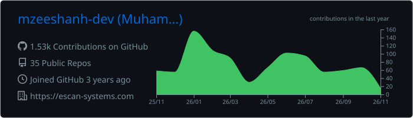
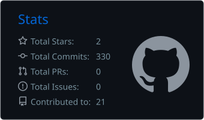
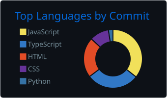

<picture>
<source media="(prefers-color-scheme: dark)" srcset="dark_mode.svg" />
<source media="(prefers-color-scheme: light)" srcset="light_mode.svg" />

</picture>

<h2 align="center">About</h2>

Software engineer with 2+ years of experience. I started on the MERN stack and now focus on <b>LLM-powered backends</b>: 
agent loops, tool calling, multi-step agent workflows, retrieval-augmented generation and LLM inference, built mainly in Node.js and TypeScript. 
Previously at Earth Scan Systems (2024 to 2026), building GIS and agritech decision-support products with NestJS, PostgreSQL and a RAG assistant.

<h2 align="center">Tech stack</h2>

 

 

<h2 align="center">Featured projects</h2>

<table>
<tr>
<td width="50%" valign="top">
<h3>🤖 Jarvis</h3>

<a href="https://github.com/mzeeshanh-dev/Jarvis----Personal-AI-Desktop-Assistant"><b>Repository</b></a> · local-first desktop AI agent

Press a shortcut, speak, and the agent opens apps, drives a browser, reads files and works with Gmail.

<ul>
<li>Planner → LLM tool-calling loop → executor, 31 tools with argument validation and approval gates</li>
<li>Groq multi-key manager: round-robin, quota freeze at 97%, circuit breaker, probe recovery</li>
<li>128 automated tests (pytest, Vitest, Playwright E2E)</li>
</ul>

</td>
<td width="50%" valign="top">
<h3>🧠 Self-hosted LLM inference</h3>

<a href="https://github.com/mzeeshanh-dev/LLM-Deployment-aws-practice"><b>Repository</b></a> · Ollama + Qwen3 on AWS EC2

An API-key protected inference service with a chat UI, built for self-hosted open models.

<ul>
<li>Docker Compose + Nginx reverse proxy + FastAPI <code>/v1/chat</code> endpoint</li>
<li>Raw vs grounded modes: grounded answers only from supplied context</li>
<li>Model, server URL and limits swapped through environment variables</li>
</ul>

</td>
</tr>
<tr>
<td width="50%" valign="top">
<h3>💻 Laptop Finder</h3>

<a href="https://github.com/mzeeshanh-dev/laptop-finder-rag"><b>Repository</b></a> · hybrid retrieval, no LLM

Conversational search over 1,275 laptops with deterministic, explainable answers.

<ul>
<li>BGE-M3 embeddings + BM25 hybrid retrieval</li>
<li>Rule-based query parsing and multi-turn dialogue memory</li>
<li>FastAPI backend, CPU-only Docker image</li>
</ul>

</td>
<td width="50%" valign="top">
<h3>💬 Chatly</h3>

<a href="https://chatly-khaki.vercel.app"><b>Live demo</b></a> · <a href="https://github.com/mzeeshanh-dev/Chatly">Web</a> · <a href="https://github.com/mzeeshanh-dev/chatly-android-app">Android</a>

Real-time direct and group messaging with web and Android clients on one Firebase backend.

<ul>
<li>Firestore listeners for messages, typing and receipts</li>
<li>Permissions enforced in Firestore security rules</li>
<li>ID-token-verified API routes, FCM push, admin portal</li>
</ul>

</td>
</tr>
<tr>
<td width="50%" valign="top">
<h3>🧰 Pixel Toolbox</h3>

<a href="https://pixel-toolbox-eta.vercel.app"><b>Live demo</b></a> · <a href="https://github.com/mzeeshanh-dev/pixel-toolbox">Repository</a>

QR generator, video-to-GIF and image converter that processes media in the browser where possible.

<ul>
<li>FFmpeg WebAssembly in a Web Worker</li>
<li>Sharp API route with Zod validation and size caps</li>
<li>IndexedDB library with version history · 122 tests</li>
</ul>

</td>
<td width="50%" valign="top">
<h3>🧩 TaaSGrid</h3>

<a href="https://taasgrid.com"><b>taasgrid.com</b></a> · source private

Talent platform covering hiring, student projects, CV tools, AI job matching and learning.

<ul>
<li>Express 5 + MongoDB API in eight modules</li>
<li>JWT in httpOnly cookies, five roles, tenant isolation</li>
<li>63 integration tests with an in-memory MongoDB</li>
</ul>

</td>
</tr>
<tr>
<td colspan="2" align="center">
<h3>⌨️ Portfolio CLI</h3>

Run my portfolio in your terminal: <code>npx @zeeshan-dev/software-engineer</code>

<a href="https://github.com/mzeeshanh-dev/portfolio-node-cli">Repository</a> · <a href="https://www.npmjs.com/package/@zeeshan-dev/software-engineer">npm package</a>

</td>
</tr>
</table>

<!-- GitHub Snake Animation: moved above GitHub Activity -->

<picture>
<source media="(prefers-color-scheme: dark)" srcset="https://raw.githubusercontent.com/mzeeshanh-dev/mzeeshanh-dev/output/github-snake-dark.svg" />
<source media="(prefers-color-scheme: light)" srcset="https://raw.githubusercontent.com/mzeeshanh-dev/mzeeshanh-dev/output/github-snake.svg" />

</picture>

<h2 align="center">GitHub activity</h2>

