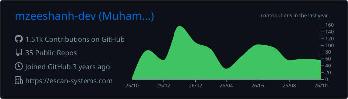
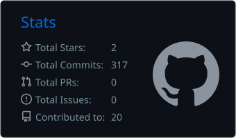
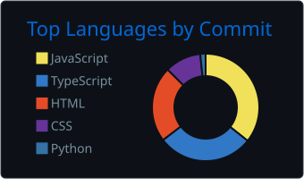

  

  

  
  
  
  

  <picture>
    <source media="(prefers-color-scheme: dark)" srcset="dark_mode.svg" />
    <source media="(prefers-color-scheme: light)" srcset="light_mode.svg" />
    
  </picture>

<h2 align="center">Tech stack</h2>

  
   
  

<h2 align="center">Featured projects</h2>

<table>
  <tr>
    <td width="50%" valign="top">
      <h3>🧩 TaaSGrid</h3>
      
<a href="https://taasgrid.com"><b>taasgrid.com</b></a> · source private

      
Talent platform covering hiring, student projects, CV tools, AI job matching and learning.

      <ul>
        <li>Express 5 + MongoDB API in eight modules</li>
        <li>JWT in httpOnly cookies, five roles, tenant isolation</li>
        <li>63 integration tests with an in-memory MongoDB</li>
      </ul>
      
      
      
      
    </td>
    <td width="50%" valign="top">
      <h3>🧰 Pixel Toolbox</h3>
      
<a href="https://pixel-toolbox-eta.vercel.app"><b>Live demo</b></a> · <a href="https://github.com/mzeeshanh-dev/pixel-toolbox">Repository</a>

      
QR generator, video-to-GIF and image converter that processes media in the browser where possible.

      <ul>
        <li>FFmpeg WebAssembly in a Web Worker</li>
        <li>Sharp API route with Zod validation and size caps</li>
        <li>IndexedDB library with version history · 122 tests</li>
      </ul>
      
      
      
      
    </td>
  </tr>
  <tr>
    <td width="50%" valign="top">
      <h3>💻 Laptop Finder</h3>
      
<a href="https://github.com/mzeeshanh-dev/laptop-finder-rag"><b>Repository</b></a>

      
Conversational search over 1,275 laptops with deterministic answers and no LLM.

      <ul>
        <li>Hybrid retrieval: BGE-M3 embeddings + BM25</li>
        <li>Rule-based query parsing and multi-turn dialogue</li>
        <li>FastAPI backend with Docker setup</li>
      </ul>
      
      
      
    </td>
    <td width="50%" valign="top">
      <h3>💬 Chatly</h3>
      
<a href="https://chatly-khaki.vercel.app"><b>Live demo</b></a> · <a href="https://github.com/mzeeshanh-dev/Chatly">Web</a> · <a href="https://github.com/mzeeshanh-dev/chatly-android-app">Android</a>

      
Real-time direct and group messaging with web and Android clients on one Firebase backend.

      <ul>
        <li>Firestore listeners for messages, typing and receipts</li>
        <li>Permissions enforced in Firestore security rules</li>
        <li>ID-token-verified API routes, FCM push, admin portal</li>
      </ul>
      
      
      
    </td>
  </tr>
  <tr>
    <td colspan="2" align="center">
      <h3>⌨️ Portfolio CLI</h3>
      
Run my portfolio in your terminal: <code>npx @zeeshan-dev/software-engineer</code>

      
<a href="https://github.com/mzeeshanh-dev/portfolio-node-cli">Repository</a> · <a href="https://www.npmjs.com/package/@zeeshan-dev/software-engineer">npm package</a>

    </td>
  </tr>
</table>

<!-- GitHub Snake Animation: moved above GitHub Activity -->

  <picture>
    <source media="(prefers-color-scheme: dark)" srcset="https://raw.githubusercontent.com/mzeeshanh-dev/mzeeshanh-dev/output/github-snake-dark.svg" />
    <source media="(prefers-color-scheme: light)" srcset="https://raw.githubusercontent.com/mzeeshanh-dev/mzeeshanh-dev/output/github-snake.svg" />
    
  </picture>

<h2 align="center">GitHub activity</h2>

  

  
  

  

  

